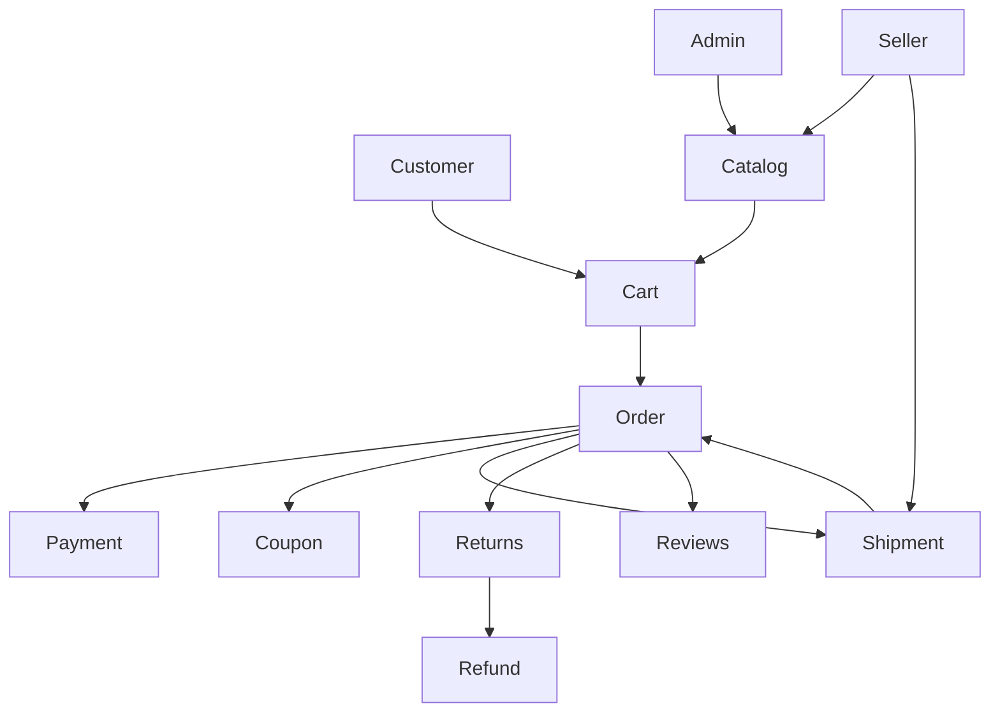
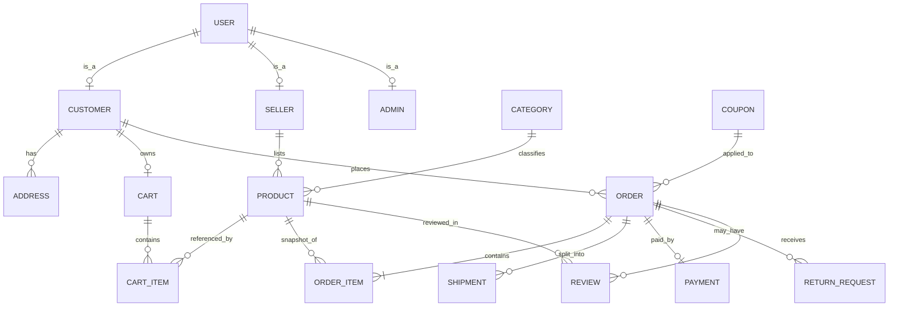

# LLD summary

## Main classes
- `User` (abstract): common identity fields; `Customer`, `Seller`, `Admin` inherit it.
- `Product`, `Cart`, `CartItem`, `Order`, `OrderItem`, `Shipment`, `Payment`, `Coupon`, `ReturnRequest`, `Review`.
- `PaymentMethod` interface with `CardPayment`, `UpiPayment`, `NetBankingPayment`, `CodPayment`.
- Services: `CatalogService`, `CartService`, `OrderService`, `PaymentService`, `CouponService`, `ReturnService`, `ReviewService`.
- `Store`: in-memory maps/lists for all runtime records.

## Important sequence: checkout
1. Validate customer cart and current stock.
2. Snapshot current product prices into `OrderItem`.
3. Calculate item subtotal, delivery fee, coupon discount and payable total.
4. Invoke selected `PaymentMethod`.
5. If online payment fails, stop; do not create order or decrement stock.
6. Create order and one shipment per seller.
7. Decrement stock and clear cart.

## Shipment state progression
`PLACED -> PACKED -> SHIPPED -> OUT_FOR_DELIVERY -> DELIVERED`.
Each shipment advances independently. Order becomes delivered only after all shipments are delivered.

## Diagrams (Mermaid)
### High-level module diagram

### Entity relationship sketch

The PDF asks for diagrams and three SQL exercises. The diagrams and SQL are included here as design references; the runnable console application stores data in memory as requested.
